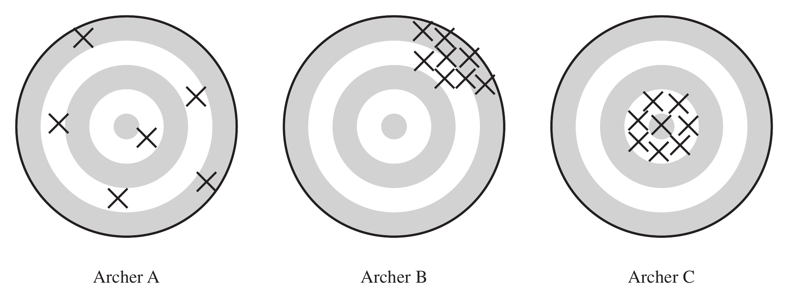

# Introduction to Sampling Survey

A sample survey collects information about a population by measuring only part
of it. This chapter introduces the main ideas. We start with a survey that went
badly wrong, then define the basic terms, describe the errors that can spoil a
survey, and sketch the main designs studied in the rest of the book. The second
half sets up the framework of probability sampling that all later chapters use:
samples and their probabilities, inclusion probabilities and sampling weights,
population quantities, sampling distributions, and bias, variance and mean
squared error. The material corresponds to Chapter 1 and Section 2.2 of Lohr, and
Chapters 2 and 3.1–3.4 of Scheaffer et al.

## A Bad Sampling Example {#sec-intro-hite}

Shere Hite's book *Women and Love: A Cultural Revolution in Progress* (1987)
reported a number of widely quoted results:

- 84% of women are "not satisfied emotionally with their relationships" (p. 804);
- 70% of all women "married five or more years are having sex outside of their marriages" (p. 856);
- 95% of women "report forms of emotional and psychological harassment from men with whom they are in love relationships" (p. 810);
- 84% of women report forms of condescension from the men in their love relationships (p. 809).

The book was widely criticized in newspaper and magazine articles throughout the
United States. The *Time* magazine cover story "Back Off, Buddy" (October 12,
1987) called the conclusions of the study "dubious" and "of limited value". The
problem was not the arithmetic but the way the data were collected:

- **The sample was self-selected.** The recipients of the questionnaire decided
  whether they would be in the sample. Hite mailed 100,000 questionnaires and
  only 4.5% were returned.
- **The questionnaires went to particular groups**, such as professional women's
  groups, counseling centers, church societies and senior citizens' centers,
  whose members may hold views different from those of other women in the United
  States.
- **The questionnaire was very long.** It had 127 essay questions, most with
  several parts. Who will tend to return such a survey? Probably women with
  strong feelings about the subject, who may differ systematically from those
  who did not reply.
- **Many questions were vague** (what counts as "love"?), which makes the
  percentages hard to interpret.
- **Many questions were leading**, suggesting to the respondent which answer to
  give.

A large number of responses (4,500) did not make up for any of these problems.
The rest of this chapter names the problems precisely, and the rest of the book
shows how a properly designed probability sample avoids the first two.

## Elements of Sampling Problems {#sec-intro-elements}

### Basic definitions

- **Observation unit.** An object on which a measurement is taken; also called
  an **element**. In studies of human populations, the observation units are
  often individuals.
- **Target population.** The complete collection of observations we want to
  study. Defining the target population is often harder than it seems. Should a
  political poll target all adults eligible to vote, all registered voters, or
  everyone who voted in the last election?
- **Sample.** A subset of a population.
- **Sampled population.** The collection of all possible observation units that
  might have been chosen in the sample: the population from which the sample was
  actually taken.
- **Sampling unit.** A unit that can be selected for a sample. We may want to
  study individuals but have no list of them. Instead we select households,
  which are then the sampling units, while the individuals remain the
  observation units.
- **Sampling frame.** A list, map or other specification of the sampling units
  from which the sample may be selected, for example a list of telephone
  numbers, street addresses or farms.

### Target and sampled populations

In an ideal survey the sampled population equals the target population. This
ideal is rarely met (@fig-target-sampled). Some members of the target population
are not in the sampling frame. Some who are in the frame cannot be reached,
refuse to respond, or are not capable of responding. And the frame may contain
units that are not eligible for the survey at all.

{#fig-target-sampled fig-align="center" width="90%"}

In the Hite study the element was an individual woman and the target population
was all adult U.S. women. The sampled population, however, was women who
belonged to the organizations that received questionnaires *and* who would
complete and return them.

## Selection Bias {#sec-intro-selection-bias}

**Selection bias** occurs when part of the target population is not in the
sampled population or, more generally, when some population units are sampled at
a different rate than intended by the investigator. A **sample of convenience**
is often biased, because the units that are easiest to select, or most likely to
respond, are usually not representative of the harder-to-select or
nonresponding units. For example:

- A convenience sample of adolescents used to study communication about AIDS
  probably overestimated how much parents and teenagers talk about it.
  Adolescents willing to talk to investigators are also more likely to talk to
  other authority figures, such as their parents.
- **Misspecifying the target population.** Polls before the 1994 Arizona
  gubernatorial primary predicted that Eddie Basha would trail by 9 or more
  points; he won with 37% of the vote. The polls targeted people who had voted
  in past primaries and missed the new rural voters who supported Basha.

Selection bias has several common sources.

**Undercoverage** is the failure to include all of the target population in the
sampling frame. The U.S. Behavioral Risk Factor Surveillance System, a telephone
survey, misses households without telephones and for many years missed
households with only cell phones. Coverage varies by region and by income, so
undercoverage can bias the estimates.

**Overcoverage** is the inclusion in the sampling frame of units that are not in
the target population, for example when interviewers include respondents under
18 in a radio survey meant for adults only.

**Nonresponse** is the failure to obtain responses from all of the units chosen
for the sample. It distorts the results even when the other sources of selection
bias are minimized. Nonrespondents often differ in critical ways from
respondents, but the extent of the difference is usually unknown. Some published
surveys have response rates as low as 10%. It is difficult to generalize from
such a survey when 90% of the sample could not be reached or refused to take
part.

## Measurement Error {#sec-intro-measurement-error}

When a response differs from the true value, **measurement error** has occurred.
**Measurement bias** occurs when the responses tend to differ from the truth in
one direction. Like selection bias, measurement bias must be considered and
minimized at the design stage; no amount of data analysis can remove it
afterwards. Some sources of measurement error:

- **People do not always tell the truth.** Farmers receiving food aid may
  underreport their crop yields, hoping to receive more aid.
- **People do not always understand the questions.** A 1993 Roper poll found that
  25% of Americans did not believe the Holocaust had happened. The question used
  a confusing double negative. When it was reworded, only 1% thought it
  "possible" that the Holocaust never happened.
- **People forget.** In the U.S. National Crime Victimization Survey (NCVS),
  respondents asked about crimes in the last six months sometimes include events
  from further back. This is called **telescoping**.

Careful questionnaire design reduces measurement error:

- **Always test the questions** on a small group before the survey is carried
  out.
- **Keep the questions simple and clear.** Belson (1981) tested the question
  "What *proportion* of your evening viewing time do you spend watching news
  programmes?" on 53 people. Only 14 interpreted "proportion" correctly, as a
  percentage, part or fraction.
- **Use specific questions instead of general ones.** Instead of asking "Did
  anyone attack you in the last six months?", the NCVS asks a detailed series of
  questions: "With any weapon, for instance a gun or knife", "With anything like
  a baseball bat, frying pan, scissors, or stick", and so on.

## Sampling and Nonsampling Errors {#sec-intro-errors}

**Sampling error** results from taking one sample instead of examining the whole
population. A different sample would likely give a different result. Sampling
error is what a poll's "margin of error" describes, and because it comes from
the random selection of the sample, it can be quantified in probabilistic terms.
Most of this book is about measuring and reducing it.

**Nonsampling errors**, such as selection bias and measurement error, cannot be
attributed to sample-to-sample variability. They are often far larger than the
sampling error. A survey may proudly report a margin of error of 3% based on a
30% response rate, while ignoring the large selection bias that such a response
rate may cause.

### Why sample at all?

If samples have errors, why not always take a census of the whole population?

- **Cost.** A sample provides reliable information at far less cost than a
  census, and with a probability sample the sampling error can be quantified.
  Some measurements are destructive (for example, pulverizing a cookie to measure
  its fat content), so a census is not even possible.
- **Speed.** Data from a sample can be collected and processed more quickly, so
  the estimates are timely. An unemployment rate for 2005 published in 2015
  would be useless.
- **Accuracy.** Estimates from a sample can be *more* accurate than those from a
  census. A census requires a large administrative effort with many data
  collectors, while a smaller operation allows the investigators to be more
  careful and to reduce nonsampling errors.

## Types of Probability Samples {#sec-intro-designs}

In a **probability sample**, every unit in the population has a known, positive
chance of being selected, and the sample is chosen by a random mechanism. This
removes selection bias due to the investigator's choices, and it makes it
possible to quantify the sampling error. Here are the main designs; each has its
own chapter later in the book.

To compare the designs we use synthetic populations of $N = 1000$ units, with
the $y$-values drawn from exponential distributions. The population for SRS and
stratified sampling (@fig-intro-srs and @fig-intro-stratified) consists of four strata of sizes 400, 300, 200 and 100 whose means differ a lot: each is an exponential distribution with mean 1.5, shifted by 0, 4, 8 and 12
respectively. The population for cluster
sampling (@fig-intro-cluster) consists of ten clusters whose sizes range from 40 to 160 units, exponential
with means from 2 to 8. Each design
selects $n = 60$ units, shown in red; the unselected units are grey.

```{r intro-synthetic-pop}
#| cache: false
#| echo: false
source("design_plots.r")
```

**Simple random sampling.** A **simple random sample (SRS)** is the simplest
probability sample. An SRS of size $n$ is taken when every possible subset of $n$
units in the population has the same chance of being the sample. The design uses
no information about the groups: in @fig-intro-srs the 1000 units are listed in
an arbitrary order, and 60 of them are chosen at random. By chance, a group may
be over- or under-represented, and the sample values range over the whole
spread of the population.

```{r fig-intro-srs}
#| cache: false
#| echo: false
#| fig-cap: "A simple random sample of $n = 60$ (red) from a population of $N = 1000$ units, listed in an arbitrary order. The dashed line is the population mean."
#| fig-width: 8
#| fig-height: 3.5
#| out-width: "85%"
plot_design_srs()
```

**Stratified random sampling.** In a **stratified random sample**, the population
is divided into subgroups called **strata**, and an SRS is selected independently
from each stratum. Strata are often subgroups of interest, such as provinces,
terrain types or firm sizes. In @fig-intro-stratified the same 1000 units are
arranged by stratum, with the strata sorted by their means (dashed lines). The sample is allocated
in proportion to the stratum sizes, $60 \times N_h/1000$, so 24, 18, 12 and 6
units are drawn from the four strata. Every stratum is represented in the sample
in a fixed proportion. Stratification often increases precision, because units within a
stratum tend to be more similar than units selected at random from the whole
population. Here the stratum means are far apart while the spread within each
stratum is small, so the differences between the strata, which make up most of
the variation in @fig-intro-srs, no longer contribute to the sampling error.

```{r fig-intro-stratified}
#| cache: false
#| echo: false
#| fig-cap: "A stratified random sample from the same population: the four strata are sorted by their means (dashed lines), and SRSs of 24, 18, 12 and 6 units (red) are drawn from the strata of sizes 400, 300, 200 and 100."
#| fig-width: 8
#| fig-height: 3.5
#| out-width: "85%"
plot_design_strata()
```

**Cluster sampling.** In a **cluster sample**, the observation units are grouped
into larger sampling units called **clusters**. For example, to survey Lutheran
church members in Minneapolis without a list of all members, we could take an SRS
of churches (the clusters) and then subsample members within each selected
church (the observation units). In @fig-intro-cluster the population consists of
ten clusters of different sizes, from 40 to 160 units, sorted by their means. Three clusters are selected at
random (shaded), and 20 units are subsampled in each. This is convenient, since
only three clusters need to be visited, but the seven clusters that are not
selected contribute nothing to the sample. When the cluster means differ, the
estimate depends heavily on *which* clusters happen to be chosen. Members of the
same church may likewise be more similar to each other than a random sample of
Lutherans would be. A cluster sample therefore often provides less information
than an SRS of the same size, and the gain in convenience must be weighed against
the loss in precision.

```{r fig-intro-cluster}
#| cache: false
#| echo: false
#| fig-cap: "A cluster sample from a population of ten clusters of 40 to 160 units, sorted by their means (dashed lines). Three clusters are selected at random (shaded), and 20 units (red) are subsampled in each; the other clusters are not observed at all."
#| fig-width: 8
#| fig-height: 3.5
#| out-width: "85%"
plot_design_cluster()
```

Later chapters add two more ingredients: estimators that use **auxiliary
information** (ratio and regression estimation), and designs that select units
with **unequal probabilities**, typically proportional to a measure of size.

## A Framework for Probability Sampling {#sec-intro-framework}

We now make the idea of a probability sample precise. The key concepts are the
population, the sample, the probabilities of the samples, the inclusion
probabilities, and the bias, variance and mean squared error of an estimator.

### The population and its samples

The finite **population**, or **universe**, of $N$ units is denoted by the index
set
$$
\mathcal{U} = \{1, 2, \ldots, N\}.
$$
Out of this population we can choose various **samples**, which are subsets of
$\mathcal{U}$. The sample actually chosen is denoted $\mathcal{S}$; it consists of
$n$ of the units in $\mathcal U$.

For example, suppose $\mathcal{U} = \{1,2,3,4\}$, so $N=4$. There are
$\binom42 = 6$ different samples of size $n=2$:
$$
\mathcal{S}_1=\{1,2\},\quad \mathcal{S}_2=\{1,3\},\quad \mathcal{S}_3=\{1,4\},\quad
\mathcal{S}_4=\{2,3\},\quad \mathcal{S}_5=\{2,4\},\quad \mathcal{S}_6=\{3,4\}.
$$

### Probability sampling

In **probability sampling**, each possible sample $\mathcal{S}$ has a known
probability $P(\mathcal{S})$ of being chosen, and the probabilities of all
possible samples sum to 1. The collection of these probabilities is the
**sampling design**. One possible design for a sample of size 2 from
$\mathcal{U}=\{1,2,3,4\}$ is
$$
P(\mathcal{S}_1)=\tfrac13,\quad P(\mathcal{S}_4)=\tfrac16,\quad P(\mathcal{S}_6)=\tfrac12,
\quad P(\mathcal{S}_2)=P(\mathcal{S}_3)=P(\mathcal{S}_5)=0 .
$$
The probabilities are known **before** the sample is drawn. One way to carry out
this design is to put six balls in a box, two labeled 1, one labeled 4 and three
labeled 6, draw one ball at random, and take the sample $\mathcal S_i$ whose label
is drawn. An SRS is the special design in which all six samples have probability
$1/6$.

### The values $y_i$

Let $y_i$ be a characteristic of the $i$th unit in the population, such as the
corn yield of farm $i$:

| $i$   | 1     | 2     | 3     | $\cdots$ | $N$   |
|:-----:|:-----:|:-----:|:-----:|:--------:|:-----:|
| $y_i$ | $y_1$ | $y_2$ | $y_3$ | $\cdots$ | $y_N$ |

We treat each $y_i$ as a **fixed** quantity. If farm 723 is in the sample, its
corn yield $y_{723}$ is known exactly; if it is not, $y_{723}$ is unknown but
still fixed. The only randomness is in *which* units are selected. This is the
**design-based** (or randomization) approach, followed by Lohr and by this book.
(Scheaffer et al. use $Y_i$ for a random variable and $y_i$ for its value.)

### Inclusion probabilities and sampling weights

Once a sampling design is chosen, each unit in the population has a known
probability of appearing in the sample, its **inclusion probability**
$$
\pi_i = P(\text{unit } i \text{ is in the sample}) = \sum_{\mathcal S \ni i} P(\mathcal S),
$${#eq-include}
the sum of the probabilities of all possible samples that contain unit $i$. In
probability sampling all the $\pi_i$ are known before the survey starts, and we
assume $\pi_i > 0$ for every unit, so that every unit has a chance to be
observed.

For the design above, unit 1 belongs only to $\mathcal S_1 = \{1,2\}$ among the
samples with positive probability, so
$$
\pi_1 = P(\{1,2\}) = \tfrac13, \qquad
\pi_2 = P(\{1,2\})+P(\{2,3\}) = \tfrac13+\tfrac16=\tfrac12,
$$
$$
\pi_3 = P(\{2,3\})+P(\{3,4\}) = \tfrac16+\tfrac12=\tfrac23, \qquad
\pi_4 = P(\{3,4\}) = \tfrac12 .
$$
The inclusion probabilities do not sum to 1. They sum to 2, because every sample
contains $n = 2$ units; in general $\sum_{i=1}^N \pi_i = n$ for a design with
fixed sample size $n$.

The **sampling weight** of unit $i$ is $w_i = 1/\pi_i$. It can be thought of as
the number of population units that a sampled unit represents. For many sampling
designs, the estimator of the population total can be written as
$$
\hat t = \sum_{i \in \mathcal{S}} w_i \, y_i = \sum_{i \in \mathcal{S}} \frac{y_i}{\pi_i}.
$$
For an SRS, $\pi_i = n/N$ and $w_i = N/n$ for every unit; for the other designs
in this book, the weights differ between units.

### Population quantities

The quantities we want to estimate are characteristics of the fixed values
$y_1, \ldots, y_N$:
$$
\textbf{total: } t = \sum_{i=1}^N y_i, \qquad
\textbf{mean: } \bar y_{U} = \frac{t}{N},
$$
$$
\textbf{variance: } S^2 = \frac{1}{N-1}\sum_{i=1}^N (y_i-\bar y_{U})^2, \qquad
\textbf{standard deviation: } S = \sqrt{S^2}.
$$
Scheaffer et al. instead use $\sigma^2 = \frac1N \sum_{i=1}^N (y_i - \bar y_{U})^2$,
dividing by $N$ rather than $N-1$. The two differ only by the factor $(N-1)/N$.

**Example: a population proportion.** Let $y_i = 1$ if unit $i$ has some
attribute and $y_i = 0$ otherwise:

| $i$   | 1 | 2 | 3 | 4 | 5 |
|:---:|:---:|:---:|:---:|:---:|:---:|
| $y_i$ | 1 | 0 | 0 | 0 | 1 |

Then the total is the number of units with the attribute and the mean is the
population proportion:
$$
t = 1+0+0+0+1 = 2, \qquad
\bar y_{U} = \frac{2}{5} = 0.4,
$$
$$
S^2 = \frac{1}{5-1}\Big((1-0.4)^2\times 2 + (0-0.4)^2\times 3\Big) = 0.3 .
$$
For a 0/1 variable, $S^2 = \frac{N}{N-1}\,p(1-p)$ with $p = \bar y_U$; here
$\frac54(0.4)(0.6) = 0.3$. As $N$ grows, $S^2 \to p(1-p)$.

**Example: number of devices per household.** A population of $N = 4$
households has the following numbers of devices:

| $i$   | 1 | 2 | 3 | 4 |
|:---:|:---:|:---:|:---:|:---:|
| $y_i$ | 2 | 4 | 4 | 6 |

$$
t = 2+4+4+6 = 16, \qquad
\bar y_{U} = \frac{16}{4} = 4, \qquad
S^2 = \frac{(2-4)^2+(4-4)^2+(4-4)^2+(6-4)^2}{4-1} = \frac{8}{3}.
$$

### Statistics and sampling distributions

A **statistic** is a function of the observations in the sample, used to
estimate a population quantity. Since the sample is random, so is the statistic.
Its **sampling distribution** is its distribution under repeated sampling: the
values it takes over all possible samples, with the probabilities
$P(\mathcal S)$ of those samples.

For example, to estimate the total $t$ we may use the sample mean scaled up by
the population size,
$$
\bar y = \frac{1}{n}\sum_{i\in\mathcal{S}} y_i, \qquad \hat t = N\bar y .
$$
Take the devices population ($\bar y_U = 4$, $t = 16$) with the sampling design of
the previous sections. For each of the six possible samples of size 2 we can
compute $\bar y$:

| $\mathcal S$ | $\{1,2\}$ | $\{1,3\}$ | $\{1,4\}$ | $\{2,3\}$ | $\{2,4\}$ | $\{3,4\}$ |
|:---:|:---:|:---:|:---:|:---:|:---:|:---:|
| values | 2, 4 | 2, 4 | 2, 6 | 4, 4 | 4, 6 | 4, 6 |
| $P(\mathcal S)$ | $1/3$ | $0$ | $0$ | $1/6$ | $0$ | $1/2$ |
| $\bar y$ | 3 | 3 | 4 | 4 | 5 | 5 |

Collecting the samples that give the same value of $\bar y$, and adding their
probabilities, gives the **sampling distribution of $\bar y$**
(@fig-intro-sampdist):

| $k$ | 3 | 4 | 5 |
|:---:|:---:|:---:|:---:|
| $P(\bar y = k)$ | $1/3$ | $1/6$ | $1/2$ |

```{r fig-intro-sampdist}
#| echo: false
#| fig-cap: "Sampling distribution of $\\bar y$ for the devices population under the design $P(\\{1,2\\}) = 1/3$, $P(\\{2,3\\}) = 1/6$, $P(\\{3,4\\}) = 1/2$. The mean of the distribution, $E(\\bar y) = 25/6$, is not the population mean $\\bar y_U = 4$."
#| fig-width: 6.5
#| fig-height: 4
#| out-width: "70%"
local({
  k <- c(3, 4, 5)
  p <- c(1/3, 1/6, 1/2)
  Eybar <- sum(k * p)
  yU <- 4
  par(mar = c(4, 4, 1, 1))
  plot(NA, xlim = c(2.5, 5.5), ylim = c(0, 0.6),
       xlab = expression(bar(y)), ylab = expression(P(bar(y) == k)),
       xaxt = "n", cex.lab = 1.3)
  axis(1, at = k)
  segments(k, 0, k, p, lwd = 3, col = "black")
  points(k, p, pch = 19, cex = 1.4)
  abline(v = yU, col = "red", lwd = 2, lty = 2)
  text(yU, 0.58, expression(bar(y)[U]), col = "red", pos = 2)
  abline(v = Eybar, col = "blue", lwd = 2, lty = 2)
  text(Eybar, 0.52, expression(E(bar(y))), col = "blue", pos = 4)
})
```

### Bias, variance and mean squared error

The sampling distribution tells us how good an estimator $\hat\theta$ of a
population quantity $\theta$ is. Three summaries are used:
$$
\text{Bias}(\hat\theta) = E(\hat\theta) - \theta, \qquad
V(\hat\theta) = E\big[(\hat\theta - E(\hat\theta))^2\big], \qquad
\text{MSE}(\hat\theta) = E\big[(\hat\theta - \theta)^2\big].
$$
The variance measures the spread of the estimates around their own mean; the
MSE measures their spread around the true value.

For $\bar y$ in the example,
$$
E(\bar y) = 3\times\tfrac13 + 4\times\tfrac16 + 5\times\tfrac12 = \frac{25}{6},
\qquad
\text{Bias}(\bar y) = \frac{25}{6} - 4 = \frac16 ,
$$
$$
V(\bar y) = \Big(3-\tfrac{25}{6}\Big)^2\tfrac13 + \Big(4-\tfrac{25}{6}\Big)^2\tfrac16
   + \Big(5-\tfrac{25}{6}\Big)^2\tfrac12 = \frac{29}{36} \approx 0.8056,
$$
$$
\text{MSE}(\bar y) = (3-4)^2\cdot\tfrac13 + (4-4)^2\cdot\tfrac16 + (5-4)^2\cdot\tfrac12 = \frac56 \approx 0.8333 .
$$
The estimator is biased under this design. The design favours the sample
$\{3,4\}$, which contains the household with 6 devices, so $\bar y$ tends to be
too large. Correspondingly $\hat t = 4\bar y$ has $E(\hat t) = 50/3 \approx 16.67$,
a bias of $2/3$ for $t = 16$.

**MSE = Bias² + Variance.** Adding and subtracting $E(\hat\theta)$,
$$
\text{MSE}(\hat\theta)
 = E\Big[\big(\hat\theta - E(\hat\theta)\big) + \big(E(\hat\theta) - \theta\big)\Big]^2
 = V(\hat\theta) + \big(\text{Bias}(\hat\theta)\big)^2 ,
$$
because the cross term $2\,\text{Bias}(\hat\theta)\,E\big[\hat\theta - E(\hat\theta)\big]$
is zero. In the example, $(1/6)^2 + 29/36 = 1/36 + 29/36 = 30/36 = 5/6$, which
agrees with the direct calculation. In particular, when $\hat\theta$ is unbiased,
$\text{MSE}(\hat\theta) = V(\hat\theta)$.

**The same population under SRS.** If instead all six samples have probability
$1/6$ (an SRS), the six values of $\bar y$ are $3, 3, 4, 4, 5, 5$, so
$E(\bar y) = 4 = \bar y_U$: the estimator is now unbiased. Its variance is
$\frac16(1+1+0+0+1+1) = \frac23$, which agrees with the SRS formula
$\big(1-\frac nN\big)\frac{S^2}{n} = \frac12\cdot\frac{8/3}{2} = \frac23$ of
@sec-srs-formulas. The short R enumeration below checks both designs.

```{r intro-enumerate-designs}
y <- c(2, 4, 4, 6)
samples <- combn(4, 2)                        # the 6 possible samples, one per column
ybar <- apply(samples, 2, function(s) mean(y[s]))
designs <- rbind(unequal = c(1/3, 0, 0, 1/6, 0, 1/2),
                 SRS     = rep(1/6, 6))
round(t(apply(designs, 1, function(P) {
  E <- sum(P * ybar)
  c(E = E, Bias = E - mean(y), V = sum(P * (ybar - E)^2), MSE = sum(P * (ybar - mean(y))^2))
})), 4)
```

### Unbiased, precise and accurate

An estimator $\hat t$ of $t$ is

- **unbiased** if $E(\hat t) = t$;
- **precise** if $V(\hat t) = E\big[(\hat t - E[\hat t])^2\big]$ is small;
- **accurate** if $\text{MSE}(\hat t) = E\big[(\hat t - t)^2\big]$ is small.

Precision measures how close the estimates from different samples are to *each
other*; accuracy measures how close they are to the *truth*. A badly biased
estimator may be very precise but will not be accurate. @fig-archers shows the
three cases as archers aiming at the centre of a target: archer A is unbiased
but imprecise, archer B is precise but biased, and archer C is both unbiased and
precise, and therefore accurate. Selection bias and measurement bias make a
survey like archer B: increasing the sample size makes the estimates more
precise, but no closer to the truth.

{#fig-archers fig-align="center" width="95%"}

### Summary

The finite population $\mathcal U$ consists of the units $\{1,2,\ldots,N\}$, with
values $\{y_1,y_2,\ldots,y_N\}$. We select a sample $\mathcal S$ of $n$ units from
$\mathcal U$ using the selection probabilities that define the sampling design.
The $y_i$ are fixed but unknown quantities, unknown unless unit $i$ happens to
appear in the sample. All statements about the bias, variance and MSE of an
estimator refer to its distribution over the possible samples. The following
chapters work out these properties for each design, starting with simple random
sampling in @sec-srs-design.
